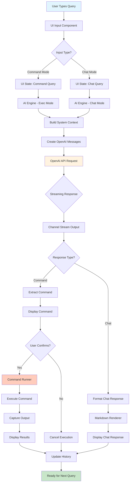

# Yai Query Flow Diagram

## Flow Description

1. **User Input**: User types a query in the terminal
2. **UI Processing**: Bubble Tea UI captures and processes input
3. **Mode Detection**: System determines if it's a command request or chat
4. **AI Engine**: Processes query with appropriate mode (exec/chat)
5. **Context Building**: Adds system information (OS, shell, user, etc.)
6. **OpenAI API**: Sends request with context to ChatGPT
7. **Streaming Response**: Receives and processes streaming response
8. **Response Handling**:
   - **Commands**: Extracts command, shows to user for confirmation
   - **Chat**: Renders markdown response
9. **Command Execution**: If confirmed, runs command via runner
10. **Output Display**: Shows command results or chat response
11. **History Update**: Stores interaction for future context
12. **Ready State**: Returns to input prompt for next query